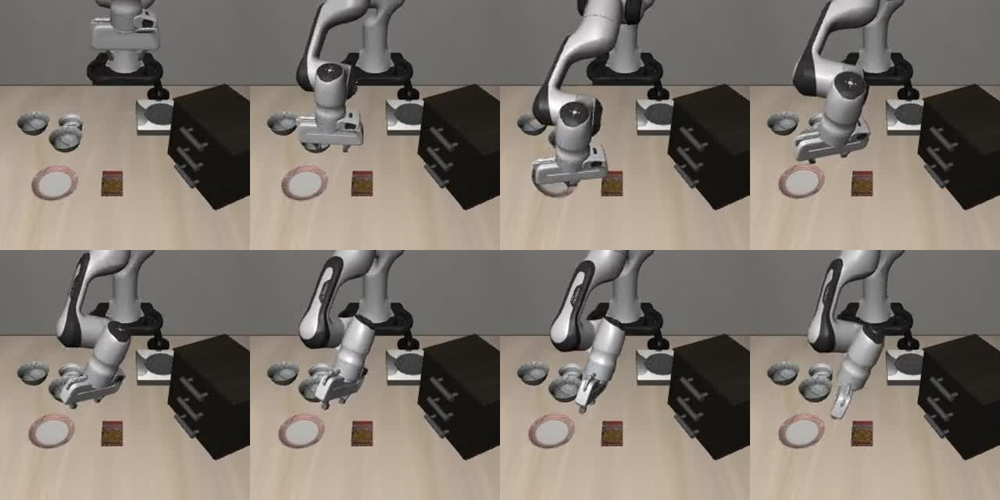
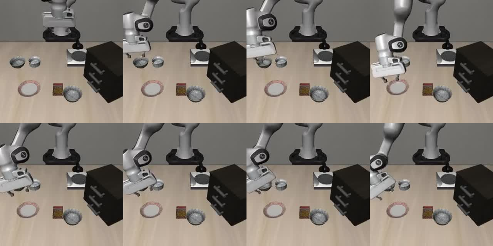
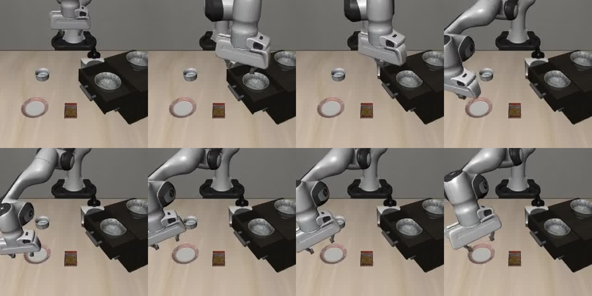

# 基线闭环评测：三个失败回合的可见现象与验证计划

本报告分析 `phase1_baseline`，对应默认动作专家微调后的正式评测。原始结果为 **76/100 回合成功**，总体成功率 76.0%，官方记录的 95% Wilson 区间约为 66.8%–83.3%。这覆盖 LIBERO-Spatial 固定五任务、一个训练种子及当前评测设置，不代表完整 LIBERO 或真机表现。

| 任务编号 | 指令中的目标 | 成功回合 / 评测回合 |
|---|---|---:|
| 0 | 将盘子与小烤盅之间的黑碗放到盘子上 | 17 / 20 |
| 1 | 将小烤盅旁边的黑碗放到盘子上 | 12 / 20 |
| 2 | 将桌面中央的黑碗放到盘子上 | 18 / 20 |
| 3 | 将饼干盒上的黑碗放到盘子上 | 18 / 20 |
| 4 | 将木柜顶层抽屉中的黑碗放到盘子上 | 11 / 20 |

下文只检查任务 0 的 episode 2、任务 1 的 episode 1、任务 4 的 episode 1，三者的原始指标均为 `success=false`。episode 编号从 0 开始。

每张图按从左到右、从上到下的顺序，展示第 0、40、80、120、160、200、240、280 控制帧，对应 20 Hz 仿真控制时间下约 0、2、4、6、8、10、12、14 秒。它们不是完整连续视频，也不包含模型推理等待时间。遮挡和抽样间隔使得瞬时接触、短暂抓取或滑落不能仅凭这些图确认。

**观察**只描述画面和已记录的结果；**假设**是可能解释；**下一步验证**尚未执行。三例并非全部失败回合的系统分类，不能据此给其余 21 个失败贴标签或统计原因比例。

## 案例一：任务 0，episode 2——末端经过盘附近，碗未见随之转移

[查看该回合视频](../assets/videos/phase1_baseline/task0_episode02.mp4)

**可见观察。** 起始画面中，多只碗位于桌面上方区域，盘位于其下方。随后夹爪靠近碗所在区域，并在中间抽样帧经过盘附近；此时没有清楚可见的碗随夹爪到达盘中。后续帧中夹爪再次回到碗附近，盘仍未见目标碗。原始指标判定该回合未成功。由于部分帧被末端遮挡，不能从图中确定是否曾短暂接触、夹持或滑落。

**待验证假设。** 抓取接触或闭合时机可能没有形成稳定搬运，而策略仍输出了向盘移动的后续动作；也可能存在抓取偏移、接触后滑落等情况。当前画面不足以确定具体原因，也不足以证明发生了目标选择错误。

**下一步单变量验证。** 固定同一 checkpoint、processor、初始状态与随机种子，保持 `chunk_size=50`、`num_steps=10` 和其余评测设置，只将 `n_action_steps` 从 10 改为 5。先在同一初值上比较是否仍出现未带碗到盘附近的行为，并记录碗的位置、末端位姿及夹爪状态；若能够读取接触信息，一并保存。该对照检验更频繁的观测更新是否有帮助，不能单独证明原因为反馈不足。本验证尚未执行。

## 案例二：任务 1，episode 1——接近源物体后移向盘，未见完成放置

[查看该回合视频](../assets/videos/phase1_baseline/task1_episode01.mp4)

**可见观察。** 桌面上有位于小烤盅旁的碗，以及盘和另一只碗。夹爪在前几个抽样帧靠近小烤盅旁的碗，随后移动到盘附近。该段画面未清楚显示目标碗被带到盘内，后续帧中源区域的碗仍可见，夹爪又回到该区域附近。指标记录为失败。抽样图不能确认目标是否曾离开桌面，也不能判断夹爪闭合命令是否正确执行。

**待验证假设。** 接近目标之后的抓取建立或保持可能失败，随后动作仍推进到运输/放置阶段；也可能是末端与碗的局部对齐存在误差。画面不足以把失败归因于语言理解、夹持力度、控制器或某一特定模型模块。

**下一步单变量验证。** 固定 checkpoint、相机和状态处理、初值与随机种子，保持 `num_steps=10`，只将 `n_action_steps` 从 10 改为 5，并保留原配置的完整对照。记录物体高度、末端与夹爪状态，观察未带起碗后的行为是否更快改变。这个实验检验反馈更新是否有助于避免继续空手移动；它不能直接证明闭合时机或夹持保持问题。该验证尚未执行。

## 案例三：任务 4，episode 1——末端离开抽屉后到达盘附近，源碗仍在抽屉

[查看该回合视频](../assets/videos/phase1_baseline/task4_episode01.mp4)

**可见观察。** 起始画面中柜子顶层抽屉已打开，抽屉内和柜顶各有一只可见的碗。夹爪先靠近抽屉内碗的位置，之后离开柜子并在盘附近运动；后续多个抽样帧中，抽屉内的碗仍清楚可见，盘上未见放入目标碗。该回合指标为失败。这支持“抽样窗口内未完成将源碗搬到盘上”的描述，但不能从中判断是否与抽屉边缘发生碰撞，或是否短暂抓住后又松脱。

**待验证假设。** 狭窄区域中的抓取对齐、夹持保持或撤离路径可能没有形成有效取物过程，策略随后继续向盘运动。也可能是其他感知或动作接口因素；不能仅凭抽屉场景就断言碰撞或路径规划失败。

**下一步单变量验证。** 在同一 checkpoint、初值、seed 和 `num_steps=10` 下，仅将 `n_action_steps=10` 改为 5，比较抽屉附近的目标物体位移与取物过程，保存末端/碗位姿和接触记录。这个实验只测试较短开环执行对该场景是否有帮助；若要进一步证明碰撞假设，仍需直接接触证据。该验证尚未执行。

## 目前可以与不可以说的结论

- 可以报告固定五任务中基线成功 76/100，并完整展示逐任务结果。任务 1、4 分别为 12/20、11/20，说明当前设置下任务之间表现不同，不能仅凭任务类型解释差异的因果来源。
- 可以报告这三个失败回合的抽样画面出现了“末端到达盘附近、源碗未见被有效转移”的现象，并提出抓取建立、保持或反馈更新等可检验假设。
- 不能说全部 24 个失败都属于“空抓”，不能把接触、闭合时机、语言理解或抽屉碰撞中的任何一种解释视为已证实原因。
- 本文没有运行上述验证，也不对其他方法或采样步数对照给出结论。后续若执行，应保留同权重/同初值的原配置结果、干预配置、原始状态记录与视频，避免只展示改善的回合。

原始指标来源为 `runs/phase1_baseline_eval/eval_info.json`，任务定义与划分来源为 `configs/data_selection.json`。
